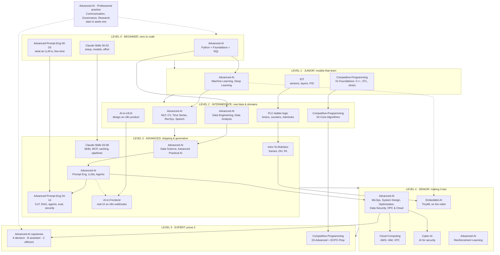

# Tayel AI Labs Courses: Org Overview & System Map

> Snapshot of https://github.com/Tayel-Ai-Labs-Courses as read on **2026-11-14** (15 repos).
> Repo names and file counts come from the GitHub API, not from memory.

## الصورة في سطرين

الـ org فيها **15 repo**: واحد كبير هو العمود الفقري (**Advanced-AI**، فيه 27 كورس)، وحواليه repos تطبيقية بتاخد اللي اتعلمته وتحطه على سطح معين (cloud، security، hardware، frontend، prompting). فيه 3 repos لسه فاضيين.

القاعدة اللي ماشية في أغلب الـ repos: **كل رقم مطبوع في الدرس جاي من run حقيقي**، وفيه `tools/check_outputs.py` بيتأكد من ده في CI.

---

## 1. كل الـ repos، وحالة كل واحد

| Repo | What it is | Size (files) | Status |
|---|---|---|---|
| [Advanced-AI](https://github.com/Tayel-Ai-Labs-Courses/Advanced-AI) | The core track: 27 courses, 26 projects, 3 capstones | 715 | Full, the spine |
| [Competitive-Programming](https://github.com/Tayel-Ai-Labs-Courses/Competitive-Programming) | ECPC/ICPC gym, C++ only, judge + stress tools | 41 | Foundations written, problem log growing |
| [Claude-Skills](https://github.com/Tayel-Ai-Labs-Courses/Claude-Skills) | Using Claude right: models, effort, Skills, MCP, tokens (Arabic) | 40 | 9 modules written |
| [Advanced-Prompt-Engineering](https://github.com/Tayel-Ai-Labs-Courses/Advanced-Prompt-Engineering) | 15 lessons, from "what an LLM is" to prompting as a business | 41 | Written |
| [Cyber-Ai](https://github.com/Tayel-Ai-Labs-Courses/Cyber-Ai) | AI for security, 5 tiers | 58 | 2 foundation tiers verified, Project 1 runnable, 3 tiers designed only |
| [Cloud-Computing](https://github.com/Tayel-Ai-Labs-Courses/Cloud-Computing) | AWS Cloud Foundations, Cloud Practitioner prep | 17 | Lessons 00-05 + 30 MCQ, lessons 06-10 pending |
| [IOT](https://github.com/Tayel-Ai-Labs-Courses/IOT) | Sensor to phone to control loop (PID), no Arduino needed | 27 | 7 lessons + 40-question bank |
| [PLC-ladder-logic](https://github.com/Tayel-Ai-Labs-Courses/PLC-ladder-logic) | Ladder logic on a Python PLC simulator, 7 exercises | 18 | 7 lessons written |
| [Intro-To-Robotics](https://github.com/Tayel-Ai-Labs-Courses/Intro-To-Robotics) | Kinematics: frames, DH, forward kinematics | 27 | Part 1 (FK) verified, Part 2 designed |
| [Embedded-AI](https://github.com/Tayel-Ai-Labs-Courses/Embedded-AI) | AI on the robot: TinyML, Edge Impulse, 3 robot projects | 33 | 12 lessons written |
| [AI-in-UIUX](https://github.com/Tayel-Ai-Labs-Courses/AI-in-UIUX) | Design the UI of an n8n automation product | 36 | Final project 1 open |
| [AI-in-Frontend](https://github.com/Tayel-Ai-Labs-Courses/AI-in-Frontend) | Build that UI for real against n8n webhooks | 34 | Final project 1 open, starter code |
| [Mathematics-for-AI](https://github.com/Tayel-Ai-Labs-Courses/Mathematics-for-AI) | Maths behind ML | 1 (LICENSE) | **Empty** |
| [AI-Software-Engineering-](https://github.com/Tayel-Ai-Labs-Courses/AI-Software-Engineering-) | (no description) | 0 | **Empty** |
| Medical-AI (private) | Medical AI basics | 0 | **Empty** |

---

## 2. جوه Advanced-AI: العمود الفقري

ده الـ repo اللي كل حاجة تانية بتتعلق بيه. متقسم 9 blocks، كل block بيفترض اللي قبله:

| Block | Courses (lessons · project) | After it you can |
|---|---|---|
| 0 · Foundations | Foundations (8 · P19), Python (22 · P1-P2), Databases & SQL (8 · P20) | Write Python, query a DB, read the maths |
| 1 · Learning from data | Machine Learning (13 · P3), Deep Learning (13 · P4) | Train and validate a model honestly |
| 2 · Domains | NLP, Computer Vision, Time Series, Recommenders, Speech & Audio | Work with text, images, time, audio |
| 3 · Real data | Data Engineering (12 · P8), Data Analysis (16 · P9) | Build pipelines, answer questions defensibly |
| 4 · Deciding & shipping | Data Science (12 · P10), Advanced Practical AI (5 sessions) | Turn a problem into a shipped decision |
| 5 · Generative | Prompt Engineering (8 · P23), LLMs & GenAI (10 · P12), AI Agents (10 · P13) | Build an LLM feature or agent that holds |
| 6 · Making it last | MLOps, AI System Design, Optimization, Data Security for AI, HPC & Cloud | Deploy, monitor, secure, shrink |
| 7 · Under uncertainty | Reinforcement Learning (10 · P11) | Decide sequentially with no labels |
| 8 · Professional practice | Communication & Docs, AI Governance, Research & Review | Write it up, read papers sceptically |
| Capstones | A: decision system · B: the assistant · C: efficient model | Prove 10+ courses in one project |

---

## 3. خريطة النظام الكاملة: من Beginner لـ Expert

الخريطة دي بتحط **كل repo فيه محتوى** في مكانه. الـ repos الفاضية مش فيها (موجودة تحت في "الفجوات").

فيه 3 مسارات بيمشوا جنب بعض بعد الأساس:
- **مسار الـ AI** (الأساسي): من Python لحد الـ capstone.
- **مسار الـ Hardware**: IoT ثم PLC ثم Robotics ثم Embedded AI.
- **مسار المنتج**: تصمم (UI/UX) وبعدين تبني (Frontend).

وجنبهم **Competitive-Programming** كتدريب مستمر من أول يوم.

### نفس الخريطة كجدول: تعمل إيه في كل مستوى

| Level | Core (Advanced-AI) | Applied repos | Exit check: you are done when you can |
|---|---|---|---|
| **0 · Beginner** | Python, Foundations, Databases & SQL | Claude-Skills 00-02, Advanced-Prompt-Eng 00-03 | Write a Python script, run a SQL query, explain what an LLM does |
| **1 · Junior** | Machine Learning, Deep Learning | Competitive-Programming 01, IOT | Train a model and say why its test score is honest |
| **2 · Intermediate** | Domains (pick one), Data Engineering, Data Analysis | Competitive-Programming 02, PLC-ladder-logic, AI-in-UIUX | Build a data pipeline and a model on text/images/time |
| **3 · Advanced** | Data Science, Advanced Practical AI, Generative block | Advanced-Prompt-Eng 04-14, Claude-Skills 03-08, Intro-To-Robotics, AI-in-Frontend | Ship an LLM feature or agent with an eval, behind a real UI |
| **4 · Senior** | MLOps, System Design, Optimization, Data Security, HPC, RL | Cloud-Computing, Cyber-Ai, Embedded-AI | Deploy, monitor, secure, and shrink a model to a device |
| **5 · Expert** | One capstone (A, B or C) | Competitive-Programming 03 + ECPC-Prep | Defend a system that uses 10+ courses, solve contest problems under time |
| **All levels** | Communication, AI Governance, Research & Review | | Write it up so someone else can use it |

### لو عندك هدف معين، امشي في المسار ده بس

| Goal | Path |
|---|---|
| AI engineer (general) | Advanced-AI blocks 0 → 1 → 3 → 4 → 5 → 6 → capstone |
| LLM / agents builder | Python → ML → Prompt Eng → LLMs → Agents → Advanced-Prompt-Eng → Claude-Skills → capstone B |
| Robotics / hardware | Python → IOT → PLC → Intro-To-Robotics → ML → Embedded-AI → capstone C |
| Security | Python → ML → Cyber-Ai (both foundations, then tiers) → Data Security for AI |
| Product / frontend | Python → Prompt Eng → AI-in-UIUX → AI-in-Frontend → LLMs |
| Cloud / deploy | Python → MLOps → HPC & Cloud → Cloud-Computing |
| Contests (ECPC) | Competitive-Programming MAP.md → 01 → 02 → 03 → ECPC-Prep |

---

## 4. الفجوات اللي الخريطة كشفتها

1. **Mathematics-for-AI فاضي** (فيه LICENSE بس)، لكن الـ roadmap جوه Advanced-AI بيشاور عليه كإنه موجود ("deeper than Foundations"). يا إما يتكتب، يا إما السهم يتشال.
2. **AI-Software-Engineering- و Medical-AI فاضيين خالص** (no commits). كمان اسم `AI-Software-Engineering-` فيه شرطة زيادة في الآخر.
3. **الـ roadmap في Advanced-AI قديم**: فيه 8 applied repos بس، ومش فيه IOT ولا PLC-ladder-logic ولا Intro-To-Robotics ولا Competitive-Programming. الخريطة اللي فوق هي النسخة المحدثة.
4. **حاجات نصها مكتوب**: Cloud-Computing (lessons 06-10)، Cyber-Ai (Beginner lessons + Intermediate + Senior designed بس)، Intro-To-Robotics (Part 2 inverse kinematics).
5. **مفيش org profile README**: الصفحة الرئيسية للـ org مفيهاش أي شرح. الملف ده ممكن يبقى `profile/README.md` في repo اسمه `.github` جوه الـ org.

## 5. قواعد مشتركة بين الـ repos

- **Every printed number is a real run**: موجودة في Advanced-AI, IOT, PLC, Robotics, Cloud, Cyber-Ai, Competitive-Programming.
- **Markdown هو المصدر**، والـ notebooks بتتولد منه (`tools/build_notebooks.py`)، ماحدش يعدلها بإيده.
- **NOTES.md بالعربي** جنب المحتوى الإنجليزي في أغلب الكورسات الجديدة.
- **Python stdlib بس** في كورسات الـ hardware والـ cloud، فمش محتاج تسطب حاجة ولا عندك board.
- **C++ في Competitive-Programming**، و Python بس كـ brute-force oracle.

