# Tayel AI Labs Courses

**From `print("hello")` to a deployed, secured, explainable AI system, and the hardware it runs on.**

12 live course repos · 27 core courses · 3 capstones · every printed number is a real run

  

## How to read the map

Pick a column and go down. Each row is a level; each arrow means "take this next".

- **AI core** ([Advanced-AI](https://github.com/Tayel-Ai-Labs-Courses/Advanced-AI)) is the spine. Everything else assumes some of it.
- **Applied AI** puts the core on a surface: prompting, Claude tooling, the cloud, security.
- **Hardware** goes from a sensor reading to a robot that runs its own model.
- **Product** designs an AI tool, then builds it for real.
- **Contests** is a gym you train in from week one, alongside everything else.

## Levels

| Level | AI core (Advanced-AI) | Applied repos | You are done when you can |
|---|---|---|---|
| **0 · Beginner** | Python, Foundations, Databases & SQL | Claude-Skills 00-02, Advanced-Prompt-Engineering 00-03 | Write a Python script, run a SQL query, explain what an LLM does |
| **1 · Junior** | Machine Learning, Deep Learning | Competitive-Programming 01, IOT | Train a model and explain why its test score is honest |
| **2 · Intermediate** | One domain (NLP, CV, Time Series, RecSys, Audio), Data Engineering, Data Analysis | Competitive-Programming 02, PLC-ladder-logic, AI-in-UIUX | Build a data pipeline and a model on text, images or time |
| **3 · Advanced** | Data Science, Advanced Practical AI, Prompt Eng, LLMs, Agents | Advanced-Prompt-Engineering 04-14, Claude-Skills 03-08, Intro-To-Robotics, AI-in-Frontend | Ship an LLM feature or agent with an eval, behind a real UI |
| **4 · Senior** | MLOps, System Design, Optimization, Data Security, HPC & Cloud, RL | Cloud-Computing, Cyber-Ai, Embedded-AI | Deploy, monitor, secure, and shrink a model onto a device |
| **5 · Expert** | One capstone: A (decision system), B (assistant), C (efficient model) | Competitive-Programming 03 + ECPC-Prep | Defend a system built from 10+ courses; solve contest problems under time |
| **Every level** | Communication & Docs, AI Governance, Research & Review | | Write it up so someone else can use it |

## Pick a path by goal

| Goal | Path |
|---|---|
| AI engineer | Advanced-AI blocks 0 → 1 → 3 → 4 → 5 → 6 → capstone |
| LLM and agents builder | Python → ML → Prompt Eng → LLMs → Agents → Advanced-Prompt-Engineering → Claude-Skills → capstone B |
| Robotics and hardware | Python → IOT → PLC-ladder-logic → Intro-To-Robotics → ML → Embedded-AI → capstone C |
| Security | Python → ML → Cyber-Ai (both foundation tiers first) → Data Security for AI |
| Product and frontend | Python → Prompt Eng → AI-in-UIUX → AI-in-Frontend → LLMs |
| Cloud and deployment | Python → MLOps → HPC & Cloud → Cloud-Computing |
| Contests (ECPC / ICPC) | Competitive-Programming `MAP.md` → 01 → 02 → 03 → ECPC-Prep |

## Every repo

| Repo | What it is | Status |
|---|---|---|
| [Advanced-AI](https://github.com/Tayel-Ai-Labs-Courses/Advanced-AI) | The core track: 27 courses, 26 projects, 3 capstones, no GPU or paid API needed | Complete |
| [Competitive-Programming](https://github.com/Tayel-Ai-Labs-Courses/Competitive-Programming) | ECPC/ICPC training gym in C++, with a local judge and stress tester | Foundations written, problem log growing |
| [Claude-Skills](https://github.com/Tayel-Ai-Labs-Courses/Claude-Skills) | Using Claude well: models, effort levels, Skills, MCP, token cost (in Arabic) | 9 modules |
| [Advanced-Prompt-Engineering](https://github.com/Tayel-Ai-Labs-Courses/Advanced-Prompt-Engineering) | 15 lessons, from what an LLM is to prompting as a business | Complete |
| [Cyber-Ai](https://github.com/Tayel-Ai-Labs-Courses/Cyber-Ai) | AI for security, in 5 tiers | Both foundation tiers + Project 1 ready; 3 tiers designed |
| [Cloud-Computing](https://github.com/Tayel-Ai-Labs-Courses/Cloud-Computing) | AWS Cloud Foundations, prep for Cloud Practitioner | Lessons 00-05 + 30-question exam; 06-10 next |
| [IOT](https://github.com/Tayel-Ai-Labs-Courses/IOT) | From a sensor reading to a PID control loop, simulated in Python | 7 lessons + 40-question bank |
| [PLC-ladder-logic](https://github.com/Tayel-Ai-Labs-Courses/PLC-ladder-logic) | Ladder logic on a small Python PLC simulator | 7 lessons |
| [Intro-To-Robotics](https://github.com/Tayel-Ai-Labs-Courses/Intro-To-Robotics) | Robot kinematics: frames, Denavit-Hartenberg, forward kinematics | Part 1 complete; Part 2 designed |
| [Embedded-AI](https://github.com/Tayel-Ai-Labs-Courses/Embedded-AI) | AI on the robot: TinyML, Edge Impulse, three robot projects | 12 lessons |
| [AI-in-UIUX](https://github.com/Tayel-Ai-Labs-Courses/AI-in-UIUX) | Design the interface of an n8n-powered AI product | Final project 1 open |
| [AI-in-Frontend](https://github.com/Tayel-Ai-Labs-Courses/AI-in-Frontend) | Build that interface for real against live n8n webhooks | Final project 1 open |
| [Mathematics-for-AI](https://github.com/Tayel-Ai-Labs-Courses/Mathematics-for-AI) | The maths behind ML, deeper than Foundations | Coming soon |
| [AI-Software-Engineering-](https://github.com/Tayel-Ai-Labs-Courses/AI-Software-Engineering-) | AI software engineering | Coming soon |

## The rules the courses keep

- **Every printed number is a real run.** In the lesson-based courses, outputs are re-checked by `tools/check_outputs.py` in CI, and when a run disagrees with the textbook, the lesson says so.
- **Markdown is the source of truth.** Notebooks are generated from it, never edited by hand.
- **Runs on a laptop.** Advanced-AI needs no GPU, paid API or cloud account; IOT, PLC and Cloud use only the Python standard library and simulate their hardware.
- **Arabic alongside English.** Most courses ship a `NOTES.md` that explains the same material in Egyptian Arabic.
